# Bass Brutalizer

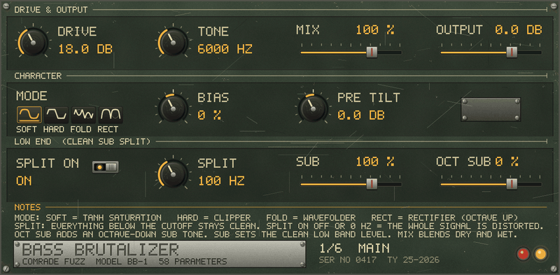

*Every screen, 2.5 seconds each (the animation loops). These are mock-ups rendered by `skin-src/make_retro_skin.py`, not photos of the device: on the MPC the parameter names and values are drawn by the MPC itself. A still gallery is under [Screens](#screens).*

Bass Brutalizer is an unholy abomination for the Akai MPC: an insert effect that takes your perfectly respectable 808, splits the clean sub away from the rest like a responsible adult, and feeds everything above it into a grinder of soft, hard, folded and rectified filth. Bitcrush it, ring-mod it, sweep it with a wobble filter, and when you run out of ideas, teach it to say "wow", "yay" and "yo" through a formant stage that has no business existing. Or give up on decisions altogether and press the big red button, which replaces every setting with a random patch at one of three sanity levels (Sober, Drunkish, Bat Shit Crazy). It wears a worn-enamel Soviet-instrument skin, because filth of this calibre deserves a proper nameplate. By comrade fuzz, probably against better advice.

Needs MPC OS 3.10.1 or later with *External Plugin Support* switched on (Preferences, Enhancements). The signal is split at **Split**: the low band can stay clean (scaled by **Sub**) while the rest goes through the damage below.

## Screens

Six function keys; the VOWEL key has four screens (press it again to page through them, the dots under its name show which one is open).

<table>
<tr><td align="center"><a href="docs/screens/01-main.png">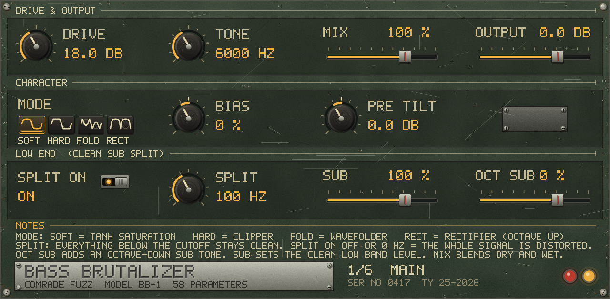</a><br><sub>MAIN</sub></td><td align="center"><a href="docs/screens/02-band.png">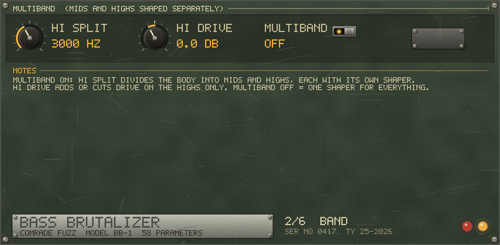</a><br><sub>BAND</sub></td><td align="center"><a href="docs/screens/03-crush.png">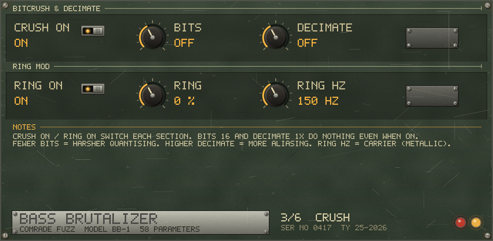</a><br><sub>CRUSH</sub></td></tr>
<tr><td align="center"><a href="docs/screens/04-wobble.png">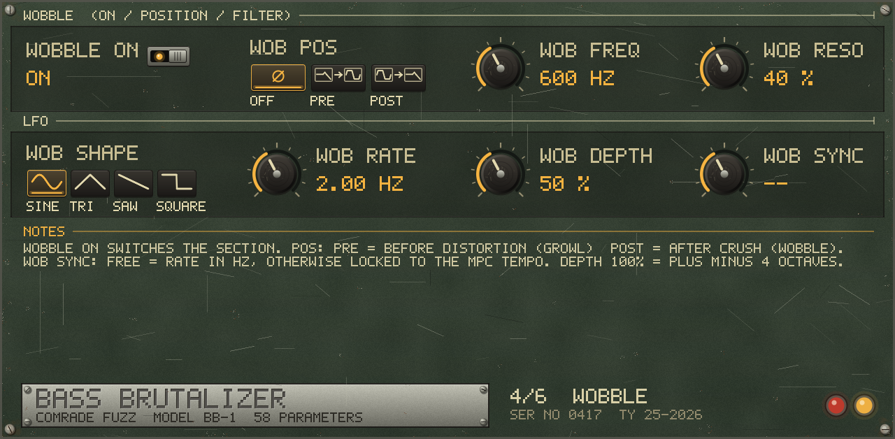</a><br><sub>WOBBLE</sub></td><td align="center"><a href="docs/screens/05-vowel.png">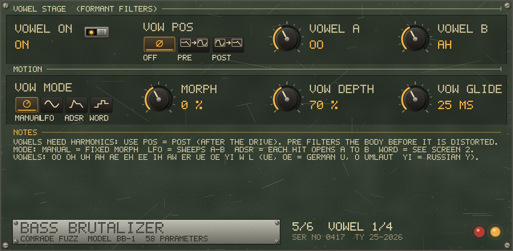</a><br><sub>VOWEL 1/4</sub></td><td align="center"><a href="docs/screens/06-words.png">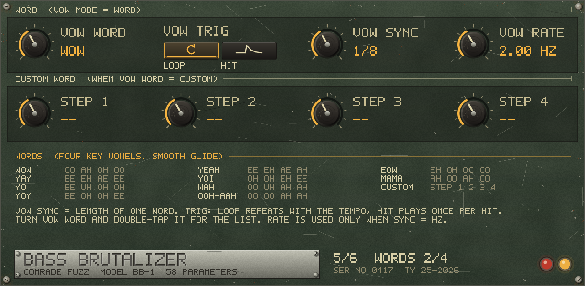</a><br><sub>WORDS 2/4</sub></td></tr>
<tr><td align="center"><a href="docs/screens/06b-words-inactive.png">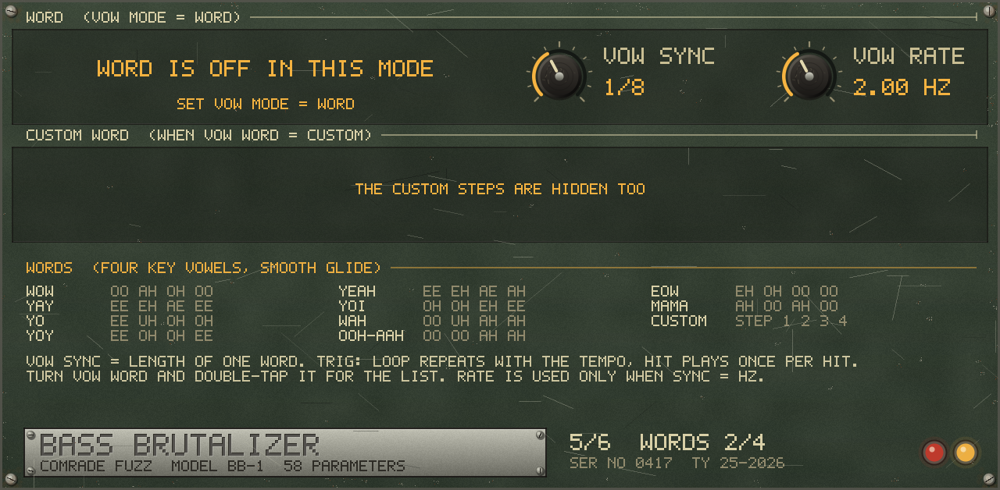</a><br><sub>WORDS 2/4, mode not Word</sub></td><td align="center"><a href="docs/screens/07-voice.png">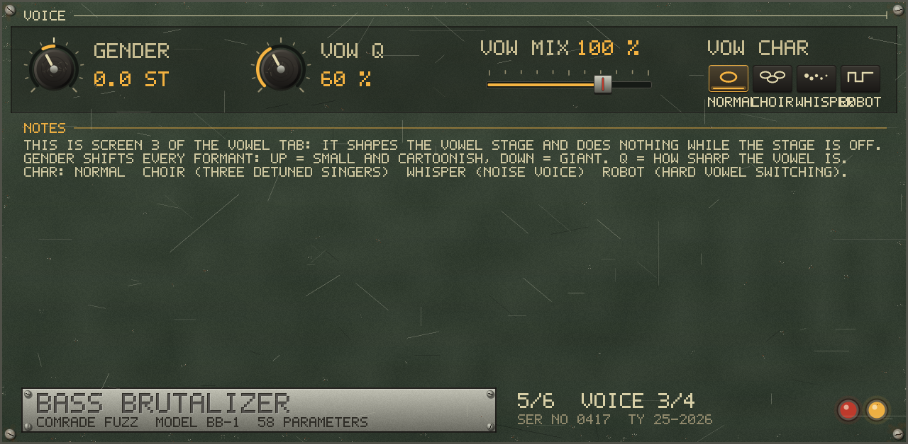</a><br><sub>VOICE 3/4</sub></td><td align="center"><a href="docs/screens/08-adsr.png">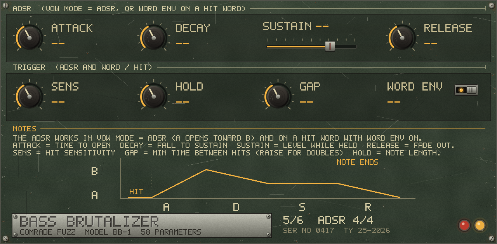</a><br><sub>ADSR 4/4</sub></td></tr>
<tr><td align="center"><a href="docs/screens/08b-adsr-inactive.png">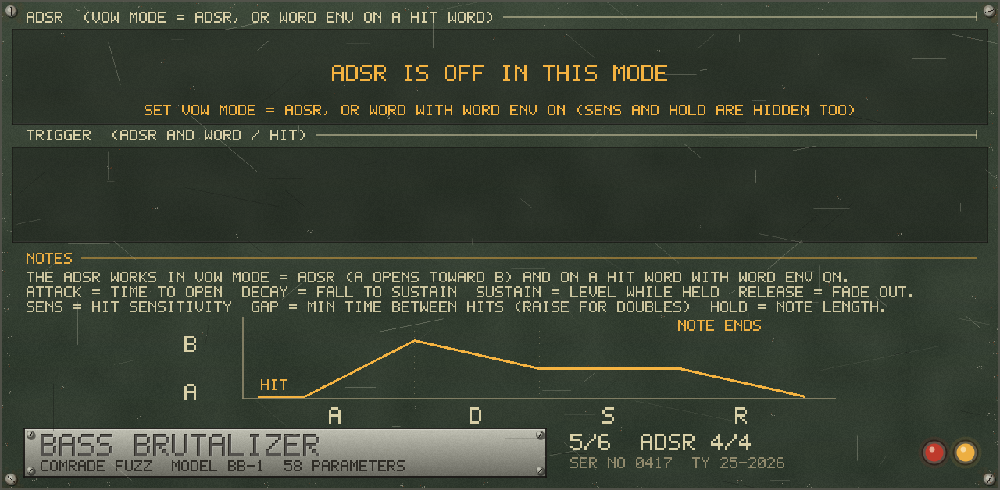</a><br><sub>ADSR 4/4, mode without ADSR</sub></td><td align="center"><a href="docs/screens/09-red-button.png">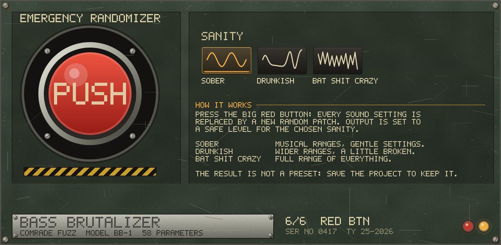</a><br><sub>RED BTN</sub></td></tr>
</table>

## Signal flow

```
dry --+--> lowpass @ Split --> low (clean sub) --- * Sub ----------------------+
      |     (Split On off or Split 0 -> low = 0)                               |
      +--> body = dry - low                                                    |
             -> Pre Tilt -> [Wobble Pre] -> Drive + Bias -> shaper (Mode)      |
             -> DC blocker -> Ring -> Bits / Decimate -> [Wobble Post]         |
             -> Tone -> level comp ----------------------------------------> (+)
dry --> octave-down generator --> * Oct Sub --------------------------------> (+)
out = dry + (wet * Output - dry) * Mix
```

## Pages and parameters

**MAIN**

| Name     | Range              | What it does |
|----------|--------------------|--------------|
| Drive    | 0..48 dB           | Gain into the waveshaper |
| Tone     | 500..20000 Hz      | 12 dB/oct lowpass after the distortion |
| Mix      | 0..100 %           | Dry/wet |
| Output   | -24..+12 dB        | Level of the processed signal (parameter 0, harmless on load) |
| Mode     | Soft/Hard/Fold/Rect | Soft = tanh, Hard = clipper, Fold = wavefolder, Rect = full-wave rectifier (octave-up fuzz) |
| Bias     | -50..+50 %         | Asymmetry before shaping: even harmonics |
| Pre Tilt | -12..+12 dB        | Before the shaper: + brightens the signal going in, - boosts its lows (changes what gets distorted most) |
| Split On | On/Off             | Enables the split chain. Off = the whole signal is distorted |
| Split    | 0..1000 Hz         | Crossover between clean sub and distorted body. 0 = Off |
| Sub      | 0..100 %           | Level of the clean low band |
| Oct Sub  | 0..100 %           | Octave-down generator: a square flip-flop on the zero crossings, rounded and following the input level. Works best on a single clean bass note; independent of Split |

**BAND**: Multiband mode (shapes mids and highs separately).

| Name      | Range          | What it does |
|-----------|----------------|--------------|
| Hi Split  | 1000..8000 Hz  | Mid/high crossover |
| Hi Drive  | -24..+24 dB    | Extra drive on the highs relative to Drive |
| Multiband | On/Off         | Off = one shaper for the whole body |

**CRUSH**

| Name     | Range        | What it does |
|----------|--------------|--------------|
| Bits     | 1..16        | Bit depth (16 = Off) |
| Decimate | 1..40x       | Sample-rate divider, aliasing on purpose (1 = Off) |
| Ring     | 0..100 %     | Ring modulation amount |
| Ring Hz  | 20..2000 Hz  | Ring modulator frequency |

**WOBBLE**: a resonant lowpass swept by an LFO.

| Name      | Range              | What it does |
|-----------|--------------------|--------------|
| Wob Rate  | 0.1..20 Hz         | LFO speed (used when Wob Sync = Free) |
| Wob Depth | 0..100 %           | Sweep depth, 100% = +-4 octaves |
| Wob Freq  | 40..8000 Hz        | Centre frequency of the filter |
| Wob Reso  | 0..100 %           | Resonance |
| Wob Pos   | Off/Pre/Post       | Pre = before the shaper (talking, formant-like), Post = after the crusher (classic dubstep wobble) |
| Wob Shape | Sine/Tri/Saw/Square | LFO shape |
| Wob Sync  | Free, 1/64 ... 2/1 | Free = Wob Rate in Hz, otherwise locked to the MPC tempo. Needs the MPC transport to report tempo (defaults to 120 bpm) |

## Programs (70)

808 and sub: Init, 808 Warm, 808 Crunch, 808 Octave, 808 Destroyed, 808 Dirty Crush, Sub Saturator.
Mid growl: Growl Mid, Reese Rot, Octave Fizz, Acid Bite, Talking Bass.
Dubstep wobble (tempo synced): Wobble 1/4, Wobble 1/8 Tri, Wobble Square, Triplet Wub, Dub Digital.
Metallic: Robot Ring, Metal Bass.
Extreme: Parallel Smash, Broken Speaker, Bright Fold, Chainsaw, Lo-Fi Grit, Wall Of Noise.
Vowels (one word per hit): YOY Hit, YOI Hit, Yeah Hit, Wow Hit, Yo Hit, Laser Yoi, Hit And Hold, Chipmunk Hit, Robot Hit.
Vowels (looping words): Wow Bass, Yay Growl, Yo-Yo, Yeah Bass, Yoi Yoi, Whisper Wub, Chipmunk, Giant Talk, Robot Vowel, Alien Eow, Dr Wub, Vowel Run, Whisper Talk, Giant Yeah, Pre Talk, Pre Growl.
Vowels (LFO sweeps): Talking LFO, Choir Bass, Wah Pedal, Growl ER, U-Umlaut Wobble, Russian Yi, Alien Choir, Choir Ahh.
Vowels (ADSR, each hit opens the mouth): Hit Opens, Vowel Bounce, Chomp, Mouth Pump, Closing Door.
Found with the Red Button (Bat Shit Crazy) and kept: Moving Harmonics, Total Filth, Dancing Dervish, Resonant Wobble, Doomsday Radio, Enough, RLY.

Tip: with Mix below 100% the dry signal still contains the sub, so "no clean sub" means Sub = 0 and Mix = 100%.

## Notes

- No oversampling: heavy drive, crushing and ring mod on bright material alias; lower Tone to tame it (or enjoy it).
- Split is a simple 12 dB/oct filter, not a phase-perfect crossover.
- High Wob Reso with Pre can get very loud; the wet signal is limited to +12 dBFS (a safety clamp, not a musical limiter). Lower Output if the next effect distorts.
- Tested in the SDK host simulator (20 checks, ~0.15% of a desktop core per block) and with a feature test: Oct Sub makes a clear octave-down tone, the wobble filter sweeps the level, tempo sync and extreme settings stay stable. Not yet tested on hardware by ear.
- Third-party plugins run unprotected inside the MPC application: save your project often.

---

## More sections added since the first version

- **Crush On, Ring On, Wobble On** switch their sections (CRUSH and WOBBLE pages).
- **RED BTN page**: a big red button replaces the sound settings with a random patch; **Sanity** (Sober, Drunkish, Bat Shit Crazy) limits how wild it may be and sets a safe Output.
- **Vowel stage** (parameters 30-57): formant filters that make vowels. 15 vowels (OO OH UH AH AE EH EE IH AW ER UE OE YI W L; UE and OE are the German umlauts, YI is the Russian "y"), moved between two of them by hand, an LFO or an ADSR, or as a **word**: a smooth glide through four key vowels (WOW, YAY, YO, YOY, YEAH, YOI, WAH, OOH-AAH, EOW, MAMA, or CUSTOM from Step 1-4). Gender shifts every formant; Choir, Whisper and Robot are alternative voices. Four screens on one key: VOWEL, WORDS, VOICE, ADSR. The Red Button randomizer includes the vowel stage.

How to use it: set **Vowel On**, **Vow Pos = Post** (after the distortion; the filters need harmonics), then pick **Vow Mode**:
- **Manual**: a fixed vowel between Vowel A and Vowel B (Morph). The sound starts on A and moves toward B.
- **LFO**: sweeps between A and B (Vow Sync as a note length, or Vow Rate in Hz when Vow Sync = Hz; Vow Depth).
- **ADSR**: every hit (a sudden rise in level, found by the hit detector) opens the vowel from A toward B with the ADSR on the ADSR screen. **Sens** sets how easily a rise counts as a hit, **Gap** the minimum time between two hits (raise it if one hit fires twice), **Hold** a fixed note length (0 = until the level has fallen about 18 dB).
- **Word**: plays the word chosen on the WORDS screen. **Vow Trig = Loop** repeats it with the tempo, **Hit** plays it once per hit. **Word Env** lets the ADSR also shape the amount of the effect on a hit word. **Vow Sync** is the length of one word.

Screens and controls that the current mode does not use are hidden, with a hint on top of the screen.

## Building

This repository is a plugin project for the [MPC Plugin SDK](https://github.com/inmusic-software/mpc-plugin-builder-sdk) (MIT).

1. Clone the SDK and put this folder at `<SDK>/plugins/Bass Brutalizer`.
2. Apply the small framework patch (preset changes refresh the MPC screen; `NaN` in a preset means "leave this parameter"):
   `git -C <SDK> apply "plugins/Bass Brutalizer/sdk-patch/framework-mpc_plugin.patch"`
3. `python3 tools/build.py "plugins/Bass Brutalizer"` (needs Python 3.9+; the Zig cross compiler is fetched automatically).
4. The touch skin in `skins/` is generated: after changing `ui.json` or the parameters run
   `python3 "plugins/Bass Brutalizer/skin-src/make_retro_skin.py"` (add `--preview` for page mock-ups in `build/`) and build again.
5. Install: copy `build/comrade fuzz - VST - Bass Brutalizer/` into a `VST2 Plugins` folder on the MPC's drive. Needs MPC OS 3.10.1+ with Enhancements → External Plugin Support enabled.

Third-party plugins run unprotected inside the MPC application: save your project often.
